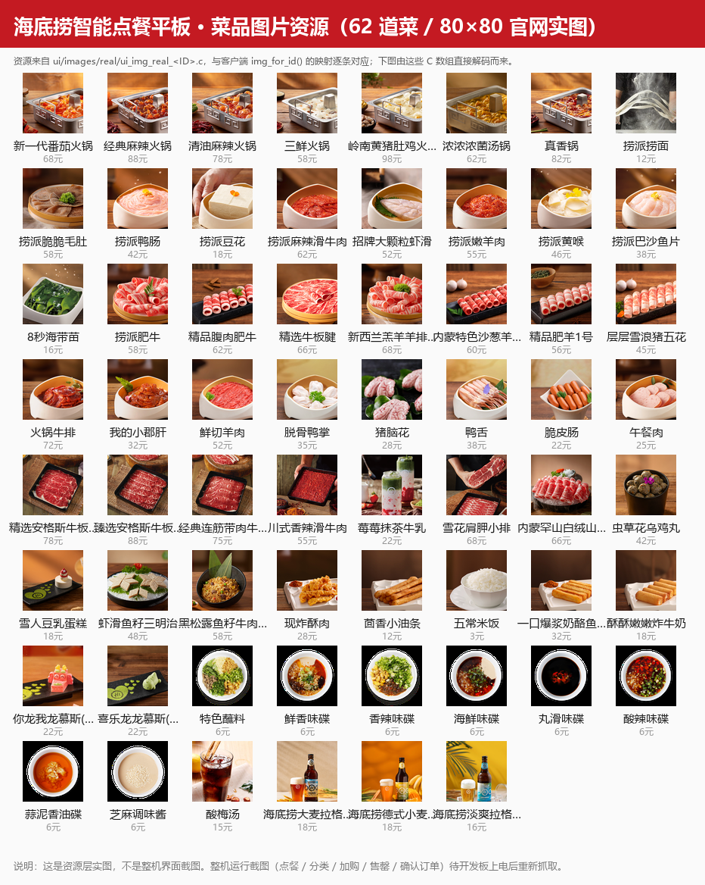

# 海底捞智能点餐平板

> 嵌入式 Linux + LVGL 触摸点餐终端（C/S 架构）  
> 独立完成 · RK3568 / 800×480 触摸屏 · 业务代码约 1879 行

板载客户端跑 **LVGL 9**（framebuffer + evdev），服务端为**单文件 C**（select 事件模型），TCP 自定义行协议；覆盖 **菜单浏览 → 购物车 → 下单 → 支付 → 出货** 全流程。

---

## 功能亮点

| 模块 | 说明 |
|---|---|
| 触摸客户端 | 800×480 三栏固定布局（header 60px / 分类 120px / 购物车 220px / 2×2 菜品卡片），订单、结算、支付三页按业务流转 |
| 服务端 | `select` 单线程事件模型，`MAX_CLIENTS=16` 并发；自定义行协议处理粘包；连接超时 2s / 业务响应超时 3s |
| 中文显示 | 交叉编译 FreeType，运行时从 TTF 取字，24px/18px 两级字号（解决真机方块字） |
| 性能实测 | 板端 **67–81 FPS**，LVGL 内存池 4MB，刷新周期 16ms |
| 双端可编译 | 同一套 UI 代码：PC 用 SDL2 仿真，ARM 用 `arm-linux-gcc` 交叉编译 |
| 业务数据 | 菜单 62 道菜 / 7 个分类常驻内存；订单号自 10001 递增；状态机驱动（模拟支付 95%、出货 96%） |

## 系统架构

```text
┌────────────────────────┐          TCP 行协议           ┌──────────────────┐
│  客户端 (RK3568)        │  ─────────────────────────►  │  服务端 (C)       │
│  LVGL 9 / fb0 / evdev  │   菜单查询 / 下单 / 支付      │  select 单线程    │
│  FreeType (simkai.ttf) │  ◄─────────────────────────  │  16 路并发        │
└────────────────────────┘      应答 / 状态回传          └──────────────────┘
```

## 菜品图片资源



62 道菜各有一张 80×80 官网实图，由 `ui/images/real/ui_img_real_<ID>.c`（LVGL RGB565/ARGB8888 数组）与 `menu_data.c` 的 `img_for_id()` 逐条对应；上图是把这些 C 数组直接解码拼出来的资源总览，不是界面合成图。

## 快速开始

```bash
# PC 仿真（SDL2）
make -f Makefile_haidilao clean && make -f Makefile_haidilao -j4
./haidilao_app

# ARM 交叉编译
make -f Make_arm clean && make -f Make_arm -j4
make -f Make_arm send          # 上传到开发板；运行需 simkai.ttf

# 服务端
cd server && make && ./haidi_server
```

依赖：LVGL 9、FreeType、SDL2（仅 PC）、`arm-linux-gnueabihf-gcc`（仅 ARM）。

## 目录结构

```text
mycode/          平台与业务：显示初始化、字体、TCP 客户端
ui/              LVGL 页面、菜单数据、图片资源
server/          C 服务端（haidi_server.c）
docs/            设计文档、测试报告、答辩材料
simkai.ttf       中文字体（真机必需）
Makefile_haidilao / Make_arm
```

> `freetype_tmp/`、`build_arm/`、第三方 `lvgl/` 源码不入库，见 `.gitignore`。

## 技术栈

`C` · `LVGL 9` · `framebuffer / evdev` · `FreeType` · `TCP 自定义行协议` · `select 多路复用` · `arm-linux-gcc 交叉编译` · `SDL2 仿真`

## 相关文档

- 需求与架构：`需求分析文档.md`、`架构设计文档.md`、`数据结构设计文档.md`
- 测试：`测试报告.md`、`功能测试报告.md`
- 答辩：`答辩讲解稿.md`
